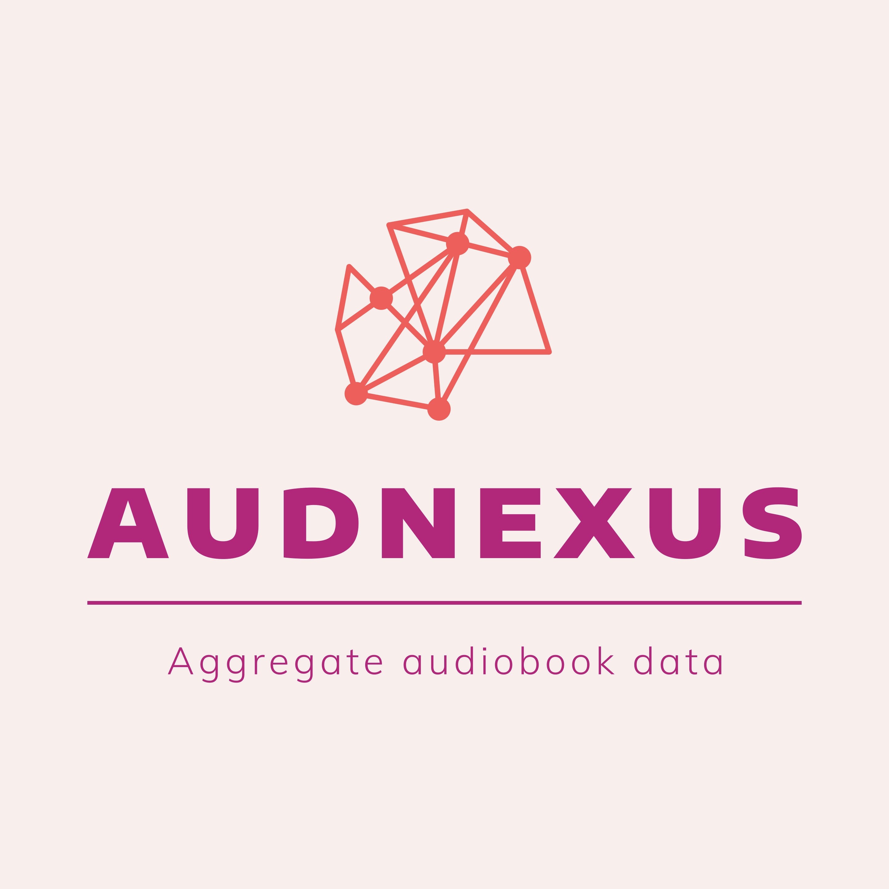

<p align="center">
  
</p>

<h1 align="center">Audnexus.bundle</h1>

**Legacy agent:** Audnexus.bundle is a Plex Music metadata agent for audiobooks. This is probably its last update.

The bundle gets author and book data from the separate [Audnexus API](https://github.com/laxamentumtech/audnexus), which stays online for existing integrations. Plex displays authors as artists and books as albums.

We recommend [AudiobookDB](https://audiobookdb.org/) for metadata, whether you [stay on Plex](#use-audiobookdb-in-plex) or [move to Audiobookshelf](#use-audiobookdb-with-audiobookshelf). AudiobookDB curates its records and separates books from individual audiobook recordings. Audnexus returns provider data as-is. You can also [keep using this bundle](#keep-using-audnexus).

## Contents

- [Legacy agents in Plex](#legacy-agents-in-plex)
- [Use AudiobookDB in Plex](#use-audiobookdb-in-plex)
- [Use AudiobookDB with Audiobookshelf](#use-audiobookdb-with-audiobookshelf)
- [Keep using Audnexus](#keep-using-audnexus)
  - [Prepare your files](#prepare-your-files)
  - [Install Audnexus.bundle](#install-audnexusbundle)
  - [Set up your library](#set-up-your-library)
  - [Agent settings](#agent-settings)
  - [Fix matches and use Quick Match](#fix-matches-and-use-quick-match)
  - [Metadata added by Audnexus](#metadata-added-by-audnexus)
- [Troubleshooting](#troubleshooting)
- [Updates](#updates)
- [Contributing](#contributing)
- [License](#license)

## Legacy agents in Plex

Both Audnexus.bundle and its successor, AudiobookDB.bundle, need a Plex Media Server that still includes legacy agents. Plex [plans to remove the legacy agent system](https://forums.plex.tv/t/announcement-custom-metadata-providers/934384) from new server releases. Its announcement describes replacement metadata providers for Movie and TV libraries, with Music to come.

On Plex Media Server 1.43.0 and later, legacy choices can be hidden when you create a library or edit one that uses a modern agent. In Plex Web, open **Settings → [your server] → Library** and enable **Show legacy agents during library setup**. Plex Support calls this **Show Legacy Agent during library set up**. Existing libraries that use legacy agents keep those choices visible. See [Plex's agent settings guide](https://support.plex.tv/articles/200241558-agents/).

This setting reveals legacy choices only while the server includes them. It cannot restore legacy support after Plex removes it.

## Use AudiobookDB in Plex

[AudiobookDB Agent](https://github.com/laxamentumtech/AudiobookDB.bundle) is a separate successor to Audnexus.bundle. You need Git on the Plex server, a server with [legacy agent support](#legacy-agents-in-plex), and an AudiobookDB account with a verified email address. Use a Music library for your books. See [file layout and tags](#prepare-your-files) if you are setting one up.

1. Install AudiobookDB Agent from source. In your Plex [Plug-ins folder](https://support.plex.tv/articles/201106098-how-do-i-find-the-plug-ins-folder/), clone its `develop` branch. See the successor's [source installation guide](https://github.com/laxamentumtech/AudiobookDB.bundle/blob/develop/README.md#source-installation) for details:

   ```sh
   git clone -b develop https://github.com/laxamentumtech/AudiobookDB.bundle.git
   ```

2. Restart Plex Media Server.
3. In your [AudiobookDB](https://audiobookdb.org/) account settings, use the **API Key** card to generate a personal key. Copy and store it securely because it is shown only once. Full-library matching requires the key.
4. In Plex Web, open **Settings → Server → Agents**, select **AudiobookDB Agent**, and open its gear. Enter the full key and save. The [successor's configuration guide](https://github.com/laxamentumtech/AudiobookDB.bundle/blob/develop/README.md#configuration) has more detail.
5. Find a title in [AudiobookDB](https://audiobookdb.org/) that matches one of your books. Note a catalog detail, such as its summary or cover. For an existing library, choose a detail that is absent or different in Plex.
6. If needed, enable the [legacy agent setting](#legacy-agents-in-plex). Create or edit your Music library. Under **Advanced**, select **AudiobookDB Agent** and save.
7. For an existing library, choose **Manage Library → Refresh All Metadata**. For a new library, let Plex scan and match the books.
8. Open that book's album in Plex and check that the detail matches AudiobookDB.

Both bundles can stay installed. When AudiobookDB resolves an existing pinned Audnexus ID, the next refresh migrates it to an AudiobookDB ID. Unresolved or ambiguous pins remain unchanged. See the [migration guide](https://github.com/laxamentumtech/AudiobookDB.bundle/blob/develop/README.md#migrating-from-audnexus) for what to do with them.

## Use AudiobookDB with Audiobookshelf

[Audiobookshelf](https://www.audiobookshelf.org/) avoids the Plex legacy agent dependency. You can use AudiobookDB data in either of these ways:

- The early, third-party [abs-audiobookdb adapter](https://github.com/H2OKing89/abs-audiobookdb) connects AudiobookDB to Audiobookshelf's custom metadata providers. It needs a running Audiobookshelf server with administrator access, an AudiobookDB API key, and a real contact email or public HTTPS contact URL for API requests. The container setup needs Docker on an Intel/AMD 64-bit host. To run without Docker, get the adapter's source and follow the [native setup](https://github.com/H2OKing89/abs-audiobookdb/blob/main/docs/deployment.md#run-without-docker) with Go 1.25 or newer. After setup, open a book's **Match** tab, select **AudiobookDB**, search, and apply a result.
- [Bragibooks](https://github.com/djdembeck/bragibooks) matches books against AudiobookDB and writes tags to processed audio files. Add the tagged output to an Audiobookshelf book library. The [Audiobookshelf metadata guide](https://github.com/audiobookshelf/audiobookshelf-docs/blob/master/docs/documentation/libraries/book-library/2.book-metadata.md) explains how it reads embedded tags and how local metadata priority can affect the result.

<a name="getting_started"></a>

## Keep using Audnexus

These instructions are for the legacy Audnexus.bundle agent. The bundle uses the public Audnexus API at `https://api.audnex.us`.

### Prepare your files

Organize your audiobooks by author and book, and set the `album` and `albumartist` tags. For example:

```text
Author Name/Book Name/Book Name: Subtitle.m4b
```

[Bragibooks](https://github.com/djdembeck/bragibooks) and [Seanap's audiobook guide](https://github.com/seanap/Plex-Audiobook-Guide) can help prepare files and tags. Plex also explains its [music folder layout](https://support.plex.tv/articles/200265296-adding-music-media-from-folders/).

### Install Audnexus.bundle

The original minimum was Plex Media Server `v1.24.4.5081`. Your server must also still include [legacy agents](#legacy-agents-in-plex). Git is needed only for the clone method.

1. On the Plex server, open its [Plug-ins folder](https://support.plex.tv/articles/201106098-how-do-i-find-the-plug-ins-folder/) and clone this repository:

   ```sh
   git clone https://github.com/djdembeck/Audnexus.bundle.git
   ```

   Alternatively, download the source ZIP from the [project page](https://github.com/djdembeck/Audnexus.bundle), extract it, and place the folder in `Plug-ins`. Rename the folder so it ends in `.bundle` and its `Contents` folder sits directly inside it. See [Plex's manual installation guide](https://support.plex.tv/articles/201187656-how-do-i-manually-install-a-plugin/).
2. Restart Plex Media Server.

### Set up your library

1. In Plex Web, create a Music library and add your audiobook folders, or edit an existing Music library.
2. In the library's **Advanced** tab, choose these settings:
   - Scanner: **Plex Music Scanner**
   - Agent: **Audnexus Agent**
   - Leave **Store track progress** checked and uncheck the other boxes.
   - Genres: **Embedded tags**
   - Album Art: **Local Files Only**
3. Save the library. For a new library, let Plex scan and match your books.
4. For an existing library, choose **Manage Library → Refresh All Metadata**. Plex refreshes authors first, then their albums. This can take some time.

Open a matched book album and look for its cover or summary. If the match is wrong or missing, try [Fix Match](#fix-matches-and-use-quick-match).

### Agent settings

In Plex Web, open **Settings → Server → Agents**, select **Audnexus Agent**, and open its gear. The defaults are:

| Setting | Default |
| --- | --- |
| Search region | `us` |
| Keep existing genres | Off |
| Append authors as Mood tags | On |
| Sort artist by last name | On |
| Simplify book titles | Off |
| Logging level | `WARN` |

The available regions are `au`, `ca`, `de`, `es`, `fr`, `in`, `it`, `jp`, `us`, and `uk`. The agent was built for English-based regions. Logging also supports `DEBUG`, `INFO`, and `ERROR`.

When enabled, **Simplify book titles** omits the separate subtitle field. It can also remove a trailing series part such as `, Book 1`, or a trailing `abridged` or `unabridged` marker, with or without parentheses.

### Fix matches and use Quick Match

In Plex Web, open the book album or author artist. Choose **… → Fix Match** (or **Match** for an unmatched item), then **Search Options**. Search by name or enter an Audible ASIN and choose the result. See [Plex's Fix Match guide](https://support.plex.tv/articles/201018497-fix-match-match/).

An ASIN bypasses the name search. Put a region code in brackets before or after the search terms to override the default region. For example, this searches the US region for *Project Hail Mary* by its Audible ASIN:

```text
[us] B08G9PRS1K
```

For a book, you can also put the ASIN and region in the filename or book folder:

```text
Andy Weir/Project Hail Mary B08G9PRS1K [us]/Project Hail Mary.m4b
```

Author Quick Matches must be entered manually. Authors cannot be Quick Matched from filenames.

Book results show the title and abbreviated author and narrator names. Some editions may look identical. A score of `100` is usually the right result, but check the narrator or use the ASIN for the recording you want. Scores consider title and author similarity, library language (2 points), and result position (a 1-point deduction per result). Music agents cannot use the Year search field.

If an author search fails, try a variation such as removing a middle initial. Some authors have no Audible profile and therefore no Audnexus author entry.

### Metadata added by Audnexus

When available, the agent adds the following:

- Artists: an image, biography, genres, and similar authors. By default, names sort by last name. Books with multiple authors appear under the first author.
- Albums: cover art up to 3200x3200, Audible user rating, release date, publisher, and a plot summary in Review. It adds up to 2 parent genres and 4 sub-genres.
- Album tags: narrators as Style, authors as Mood when enabled, and series as Mood with a `Series:` prefix. Albums sort by series number and then title.

The agent cannot create series collections itself. The [Audnexus and Kometa guide](https://github.com/book-tools/audnexus-kometa-series) explains how to create them from the series Mood tags.

## Troubleshooting

If an agent does not appear in the library's **Advanced** settings:

1. Check that the bundle is directly inside Plex's `Plug-ins` folder and that its `Contents` folder is directly inside the bundle.
2. Restart Plex Media Server.
3. Check that your server still includes legacy agents and that the [legacy agents setting](#legacy-agents-in-plex) is enabled when needed.
4. Check that you are creating or editing a Music library.

For an incorrect match, check the file layout and tags, then try [Fix Match or an ASIN](#fix-matches-and-use-quick-match). For a library using AudiobookDB Agent, see its [migration guide](https://github.com/laxamentumtech/AudiobookDB.bundle/blob/develop/README.md#migrating-from-audnexus) for unresolved pins.

For a failed AudiobookDB refresh, see the successor's [API details](https://github.com/laxamentumtech/AudiobookDB.bundle/blob/develop/README.md#api-details). It covers key, throttling, and network errors.

## Updates

For a Git installation of Audnexus.bundle, run this command inside the `Audnexus.bundle` folder, then restart Plex Media Server:

```sh
git pull
```

For a ZIP installation, download and extract the [source ZIP](https://github.com/djdembeck/Audnexus.bundle/archive/refs/heads/main.zip). Rename the extracted folder to `Audnexus.bundle`, with `Contents` directly inside it. Remove the old Audnexus bundle folder from `Plug-ins`, then move the extracted folder there. Leave your audiobook files and Plex library data untouched. Restart Plex Media Server.

See the [changelog](CHANGELOG.md) and [releases](https://github.com/djdembeck/Audnexus.bundle/releases) for changes.

## Contributing

See [CONTRIBUTING.md](CONTRIBUTING.md).

## License

See [LICENSE](LICENSE).
